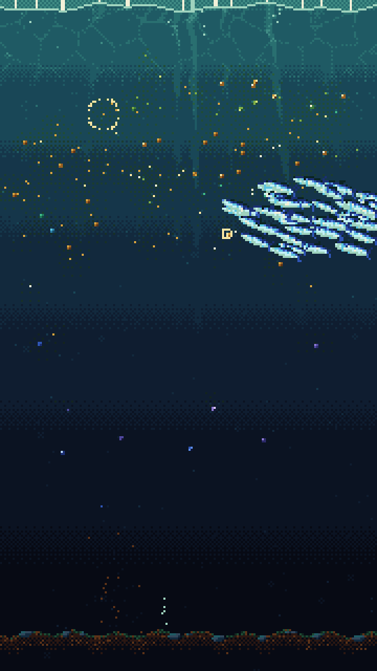
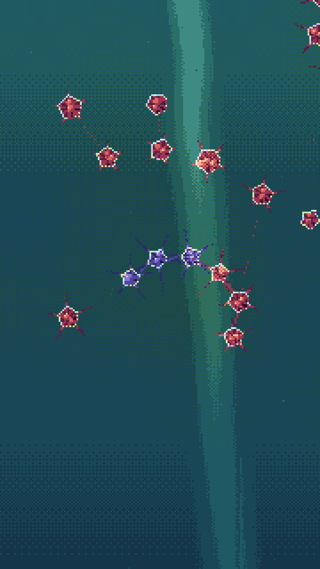
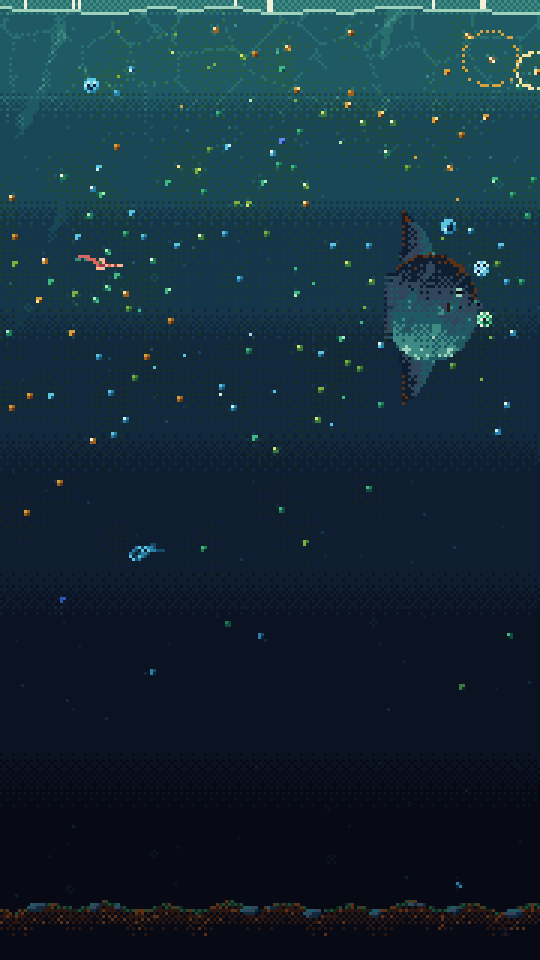
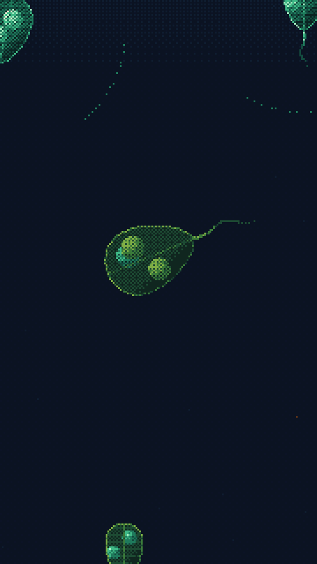
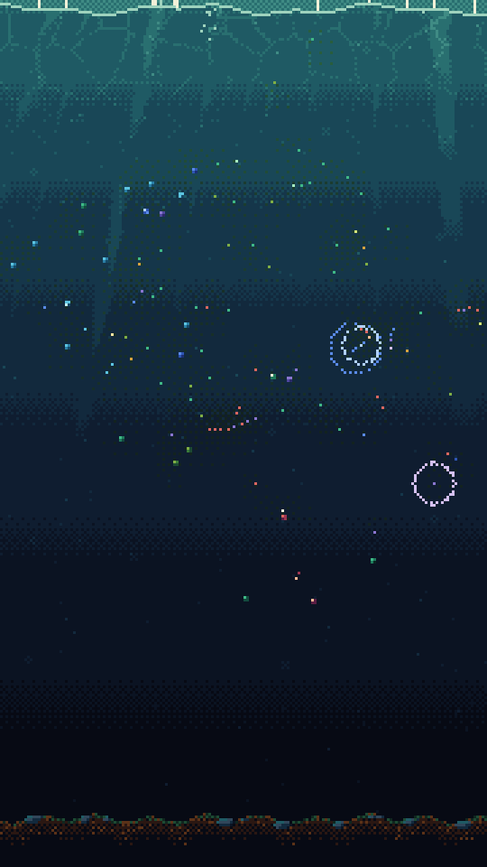

# MONAD

**A water column of living phytoplankton that plays its own ambient music. Nobody composes it.**

### [Open MONAD](https://vitorhugo1992.github.io/monad/) · tap the water to listen

  
  
  
  
  

Pixel-art phytoplankton drift, grow, divide, synchronise and die in a dark water column, and every note you hear
comes from one of them. Diatoms sing like glockenspiels and vibraphones, dinoflagellates like wood and plucked
strings, green algae like a felt piano, coccolithophores like a celesta and cryptophytes like a kalimba. Blooms swell into chords; die-offs fall silent. You can just watch
it, like a tide pool, or put your hand in the water.

## The idea: emergence, not authorship

Nothing in MONAD is scripted. There are no "bloom events", no species types, no composed melodies. There is a
short list of local rules, and everything else comes out of how they interact:

- **Light and drift.** Light enters from the top and fades with depth through a day–night cycle (one day lasts
  five minutes). Cells swim toward the light level they prefer, and at night they follow the nutrients down,
  so the population migrates up and down every day, as real plankton do.
- **Growth.** Cells photosynthesise from light and nutrients. Small cells win in bright, poor water; large
  cells endure the dim depths. Wind stirs up nutrient-rich water from below, and calm spells favour
  dinoflagellates while storms favour diatoms.
- **Division and inheritance.** A well-fed cell divides into two daughters with slightly mutated genes. Every
  gene is something you can see or hear: colour, size, preferred depth, pulse rate, how strongly it syncs
  with its neighbours, and its form (and with it its instrument).
- **Nine forms, each with its niche.** Green algae; coccolithophores, wrapped in chalk plates (slow growers that
  win in poor, calm water and turn it milky when they bloom); cryptophytes (masters of dim light, and
  Dinophysis's favourite prey); four dinoflagellates (*Alexandrium*, *Dinophysis*, *Tripos*, *Prorocentrum*);
  centric and pennate diatoms. Their colours follow their real pigments: golden-brown diatoms, rust-brown
  dinoflagellates, green algae, yellow-to-green coccolithophores, red-to-blue cryptophytes.
- **Death and recycling.** Cells die of starvation or old age, and their nutrients return to the water or
  sink to the floor. Some leave dormant cysts in the sediment that can bring the water back to life later.
- **Grazers and visitors.** An invisible field of grazers grows where cells are dense and starves away
  slowly, which ends blooms and lets the water recover. Big blooms draw in sardine schools and salp chains,
  and the salps draw in an ocean sunfish.
- **Succession.** As in the real ocean, no group keeps the water for long:
  - **Silicate:** diatoms need silica for their glass. It stays in the shell until the cell dies, then mostly
    sinks, so a diatom bloom strips the surface of silica and opens the water to the others.
  - **Viruses:** each kind of cell has its own, and its risk rises with how crowded its kind is, so whatever
    dominates gets hit hardest ("kill the winner"). Burst cells feed their neighbours.
  - **Dinophysis steals its chloroplasts:** it hunts the cells it meets and keeps one of their chloroplasts,
    so it slowly becomes a patchwork of its prey's colours. Stolen chloroplasts wear out, so it must keep
    hunting, and it meets the commonest prey most.
  - **Immigration:** "everything is everywhere, but the environment selects." Now and then a single newcomer
    drifts in from the open ocean. Most vanish; when the water turns their way, their kind is already there.
- **Synchrony.** Each cell pulses with its own rhythm and nudges its phase toward its neighbours'
  (a Kuramoto model). Related cells lock together and flash as one; colonies and chains appear without any
  colony code.
- **Harmony.** Each cell holds a note in one shared scale. When it flashes it may sing, and it bends its note
  toward a consonant interval with what its neighbours sang. Chords form from proximity and synchrony. Each
  lineage carries a short tune that it passes to its daughters, slowly changing down the generations.

The music works through constraints rather than randomness: one tonal centre at a time, depth sets the
register (the surface sings high, the deep sings low), and a strict voice budget means silence is allowed and
expected. The oldest cells living in the deep become elders that drone, and the oldest elder holds the key;
when it dies, the whole water may modulate.

The author studies phytoplankton, so the biology is meant to carry weight: size allometry, Margalef's mandala
(turbulence against dinoflagellates), a lagged grazer response, the biological pump, resting cysts, diel
vertical migration, silica limitation, viral lysis and the viral shunt, kleptoplasty, and a seed bank of
newcomers.

## Playing

- **Tap** the water: nearby cells startle, flash and dart away.
- **Swipe** through the water (zoomed out): every cell you pass plucks its own note, like strumming a harp.
  Moving toward the surface brightens the sound, toward the deep darkens it; moving sideways makes the filter
  ring, its peak following your finger from low on the left to high on the right.
- **Pinch** or scroll to zoom in up to 8× and see the cells in detail; drag to pan.
- The small **book** at the top right opens a field notebook: the day, a census of the forms, the water
  (nutrients, silica and grazers over time, lined up with the population of each form, so you can watch the
  succession happen), their daily migration, and a ledger of deaths (grazed, eaten by fish, hunted, lysed by
  viruses...) and visitors. The **note** beside it turns the music off and on.

## A world that keeps living

MONAD keeps one world on your device. Close it, come back later, and the water has lived the time you were
away: the missed hours are simulated exactly, shown as a silent time-lapse that slows into the live world.
Up to 12 hours are lived; beyond that the water rests, and the notebook marks the gap.

Worlds can die. Crashes run deep, and now and then the last cell and the last cyst are gone. The water goes
on, empty and silent, with an epitaph. A tap seeds new water. You can also end a living world yourself: the
notebook's last page ends with **NEW WATER**, which asks before it lets the old world go.

## Install it on your phone

On Android, open **[vitorhugo1992.github.io/monad](https://vitorhugo1992.github.io/monad/)** in Chrome,
then choose **⋮ → Install app**. It runs full screen and offline, and updates itself.

## Under the hood

- **One file.** The whole app is `index.html`: vanilla JavaScript, Canvas 2D and the Web Audio API, with no
  frameworks and no build step. The other files (`manifest.webmanifest`, `sw.js`, `icons/`) are only what
  installing needs.
- **Pixel art from a fixed palette.** Everything renders at 180 × 320 pixels from a palette of 53 colours,
  with ordered dithering instead of gradients, and is scaled up by whole numbers.
- **Deterministic.** All randomness comes from one seeded generator, the simulation runs at a fixed 30 ticks
  per second, and its maths avoids anything that could differ between JavaScript engines. The same seed grows
  the same world on any device, bit for bit, and a saved world resumes exactly where it stopped.
- **Tested headless.** `node tools/sim-check.mjs [seeds] [minutes]` fast-forwards many worlds without a
  browser and reports population cycles, migration, synchrony, chains, the music the voice budget lets
  through, nutrient conservation, determinism and the save/restore round trip.

Options for exploring (these start a separate scratch world that is never saved):
`?seed=` a number or word · `?speed=2|4|8` time-lapse · `?day=5|10|30` minutes per day ·
`?zoom=1..8&at=x,y` · `?debug` (or `D`) the fields, population and voice overlay · `?bench` how fast your
device lives a world out of sight.
